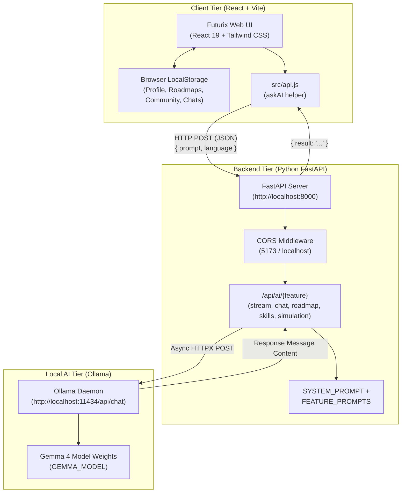
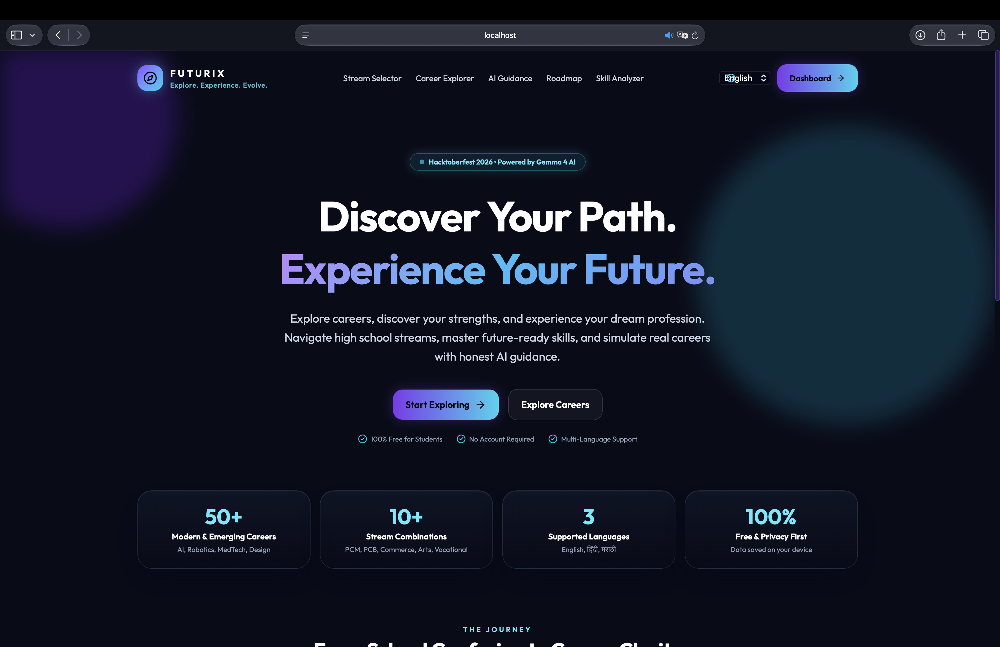
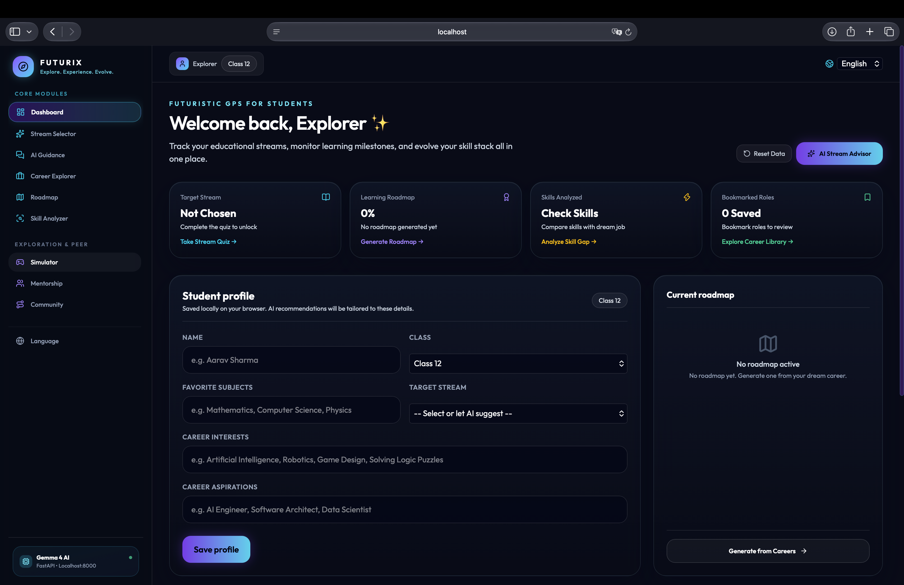
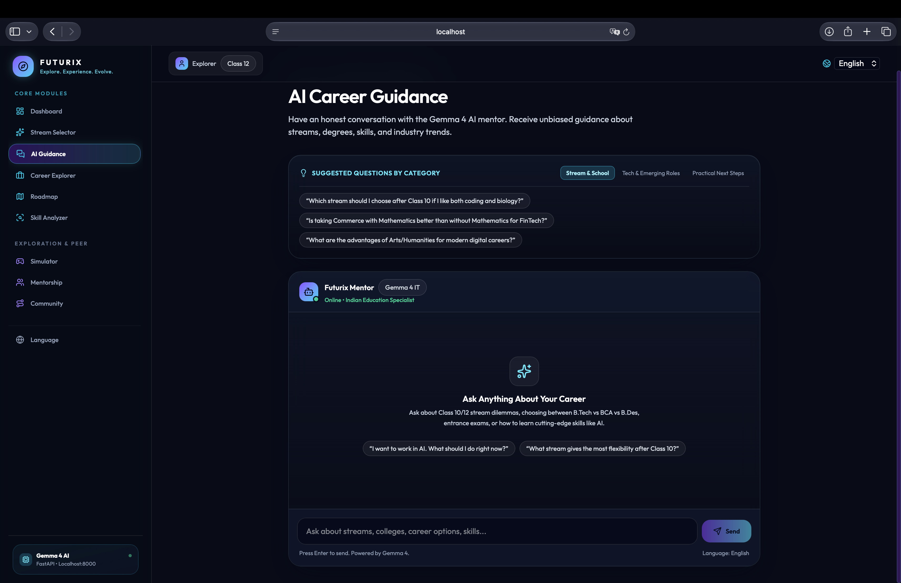
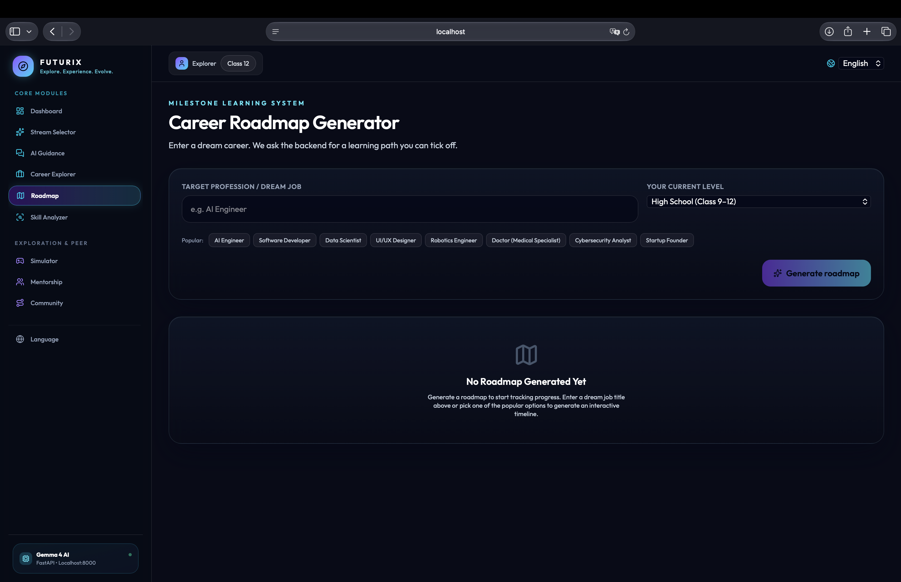
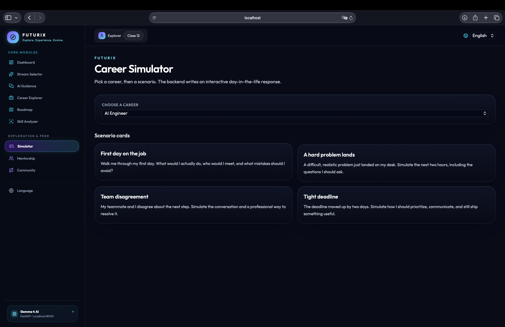
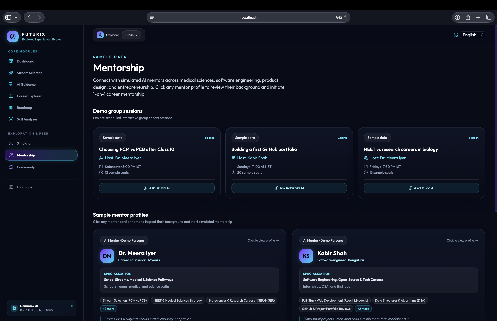
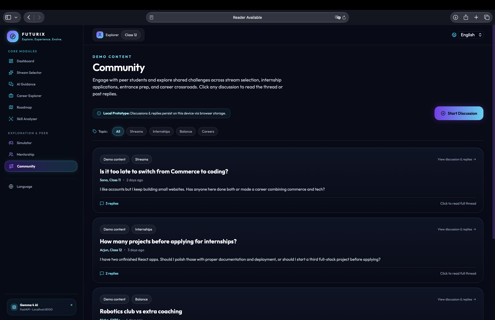

# Futurix

> **Explore Your Future Before You Choose It.**

[](https://hacktoberfest.com/)
[](https://react.dev/)
[](https://tailwindcss.com/)
[](https://fastapi.tiangolo.com/)
[](https://ollama.com/)

---

## 1. Project Title & Tagline

* **Project Name:** Futurix
* **Tagline:** *Explore Your Future Before You Choose It.*

---

## 2. Project Overview

**Futurix** is an AI-powered career exploration and guidance platform designed to empower students (from secondary school through undergraduate degrees) to make informed, realistic, and confident career decisions. 

Rather than relying on generic quizzes or promotional advice from coaching centers, Futurix provides an interactive, student-centric experience. Using open-weights **Gemma 4** running locally through **Ollama**, Futurix provides contextual educational stream recommendations, verified career roadmaps, real-time skill gap evaluations, simulated day-in-the-life workplace scenarios, personalized AI mentorship, and peer discussion spaces.

---

## 3. Problem Statement

Students in secondary school and early college face severe information asymmetry when planning their futures:

1. **Rote Stream Allocation:** Students completing Class 10 or secondary school are frequently pushed into Science, Commerce, or Arts based on generic marks or peer pressure rather than genuine aptitude.
2. **Abstract Career Awareness:** Standard guidance counselors explain *titles* (e.g., "Software Engineer" or "Data Scientist") without explaining the daily realities, toolchains, or challenges of the actual profession.
3. **Vague Learning Pathways:** Students often do not know which entrance exams (e.g., JEE, NEET, CUET, UCEED), degrees, certifications, or open-source projects bridge the gap between their current grade and their dream job.
4. **Commercial Bias & High Costs:** High-quality career counseling is often expensive and tied to institutes attempting to sell coaching packages, obscuring affordable and vocational routes.

---

## 4. Our Solution

Futurix addresses these gaps through an intuitive, accessible platform built with open-source technologies:

* **Objective & Honest Guidance:** Powered by Gemma 4 with explicit ethical system prompts, Futurix offers balanced insights without commercial bias, unrealistic salary guarantees, or promotional claims.
* **Interactive Career Simulations:** Students experience hands-on workplace decision scenarios to see what practicing professionals actually do before committing years to a specialized degree.
* **Granular Milestone Roadmaps:** Breaks large careers into verifiable, checklist-driven learning stages with estimated durations and recommended free resources.
* **Privacy-First Local Storage:** Student profile information, roadmap milestones, skill checklists, mentor chats, and community posts are stored directly in the browser's `localStorage`—no tracking, no forced registrations, and no third-party data harvesting.

---

## 5. Key Features

### 1. AI-Powered Career Guidance
* **AI Stream Selector:** Evaluates student subjects, aptitudes, and passions to rank optimal academic streams (Science PCM, Science PCB, Commerce with/without Maths, Arts/Humanities, and Vocational/Polytechnic pathways).
* **AI Career Mentor:** Conversational career guidance interface where students ask candid questions regarding degree choices, entrance exam trade-offs, and emerging field opportunities.

### 2. Personalized Career Roadmaps
* Generates step-by-step milestones tailored to the student's current grade (High School, Undergrad, or Career Switcher).
* Includes interactive completion checkboxes, a live progress indicator bar, an option to add custom user milestones, and an export transcript feature.

### 3. Skills Analysis (Dream Job Skill Analyzer)
* Evaluates the student's existing skillset against current market expectations for any target profession.
* Identifies strengths, highlights missing competencies, outlines free learning platforms, and features an interactive skill tracker.

### 4. Interactive Career Simulation
* Places students inside realistic workplace scenarios (e.g., "First day on the job", "A hard problem lands", "Team disagreement", "Tight deadline").
* The AI simulator evaluates student responses, highlights strengths, suggests areas for improvement, and demonstrates stronger approaches.

### 5. AI Mentorship
* Provides simulated 1-on-1 mentorship with demo domain specialist personas (e.g., Clinical Medicine, Cloud Systems, Product Design, CleanTech).
* Preserves conversation history locally and supports prompt follow-ups.

### 6. Community Discussions & Replies
* A peer discussion board categorized by topics (Streams, Careers, Internships, Exams, Habits).
* Students can start new threads, read discussion topics, and post replies.
* *Note on Community Persistence:* Community discussions and replies are stored in the user's browser via `localStorage` as a client-side prototype.

### 7. Student Dashboard
* Central hub displaying target stream status, active roadmap completion percentages, bookmarked career roles, and mastered skills count.
* Enables students to manage their profile locally and reset data whenever needed.

---

## 6. Technology Stack

| Layer | Technology | Purpose |
| :--- | :--- | :--- |
| **Frontend Framework** | [React 19](https://react.dev/) + [Vite 8](https://vite.dev/) | High-performance single page application with rapid Hot Module Replacement (HMR). |
| **Routing** | [React Router DOM v7](https://reactrouter.com/) | Client-side routing and deep linking across all pages. |
| **Styling & UI** | [Tailwind CSS v4](https://tailwindcss.com/) | Futuristic dark navy UI, purple/cyan gradients, and responsive glassmorphism. |
| **Icons** | [Lucide React](https://lucide.dev/) | Clean, accessible iconography. |
| **Backend API** | [FastAPI](https://fastapi.tiangolo.com/) + [Uvicorn](https://www.uvicorn.org/) | Asynchronous Python REST API handling request validation and streaming. |
| **HTTP Client** | [HTTPX](https://www.python-httpx.org/) | Async HTTP requests between FastAPI and Ollama. |
| **AI Inference** | [Gemma 4](https://ai.google.dev/gemma) via [Ollama](https://ollama.com/) | Local open-weights large language model execution. |
| **Local State** | Browser `localStorage` | Client-side persistence for profile, roadmaps, chat transcripts, and community threads. |
| **Version Control** | Git + GitHub | Collaborative version control and open-source submission tracking. |

---

## 7. System Architecture



### Verified API Endpoints (`backend/main.py`)

All AI capabilities route through the verified REST endpoints:

* `GET /` — API root status check (`{"message": "Futurix backend is running", "docs": "/docs"}`).
* `GET /health` — Health check returning server status and the currently configured `GEMMA_MODEL`.
* `POST /api/ai/stream` — Generates stream recommendations based on student strengths and interests.
* `POST /api/ai/chat` — Mentorship conversation endpoint for direct guidance queries.
* `POST /api/ai/roadmap` — Generates sequential numbered milestone roadmaps.
* `POST /api/ai/skills` — Compares student skills against target dream career requirements.
* `POST /api/ai/simulation` — Evaluates student responses to workplace role-play scenarios.

---

## 8. Installation Requirements

Ensure you have the following prerequisites installed on your system:

* **Node.js:** v18.0.0 or later (Node.js v20+ recommended)
* **npm:** v9.0.0 or later
* **Python:** v3.10, v3.11, or v3.12
* **Ollama:** Installed from [ollama.com](https://ollama.com/)
* **Git:** Installed and configured

---

## 9. Frontend Installation

Clone the repository and install the frontend dependencies:

```bash
# 1. Clone the repository
git clone https://github.com/your-org/futurix.git
cd futurix

# 2. Install Node dependencies
npm install
```

---

## 10. Backend Installation

Set up a Python virtual environment and install the required dependencies:

```bash
# 1. Navigate to the backend directory
cd backend

# 2. Create a virtual environment
python3 -m venv .venv

# 3. Activate the virtual environment
# On macOS / Linux:
source .venv/bin/activate
# On Windows (Command Prompt):
# .venv\Scripts\activate.bat
# On Windows (PowerShell):
# .venv\Scripts\Activate.ps1

# 4. Install backend dependencies
pip install -r requirements.txt
```

---

## 11. Ollama Model Configuration

Futurix utilizes **Gemma 4** through Ollama for fast, private, and local inference without requiring paid API keys.

1. **Start the Ollama daemon:**
   ```bash
   ollama serve
   ```

2. **Pull the Gemma model:**
   ```bash
   # Pull the desired Gemma model tag
   ollama pull gemma:latest
   ```

3. **Verify running models:**
   ```bash
   ollama list
   ```

### Backend Environment Variables

The backend reads configuration directly from environment variables:

| Variable | Default Value | Description |
| :--- | :--- | :--- |
| `GEMMA_MODEL` | `""` (Required) | The tag of the installed Ollama model (e.g. `gemma:latest`, `gemma2:9b`, or custom Gemma 4 tag). |
| `OLLAMA_URL` | `http://localhost:11434/api/chat` | The endpoint for Ollama's chat API. |

Export the variables before starting the backend:

```bash
export GEMMA_MODEL="gemma:latest"
export OLLAMA_URL="http://localhost:11434/api/chat"
```

---

## 12. How to Run Futurix

To run the complete Futurix platform locally, open three terminal tabs:

### Terminal 1: Run Ollama
```bash
ollama serve
```

### Terminal 2: Run FastAPI Backend
```bash
cd backend
source .venv/bin/activate
export GEMMA_MODEL="gemma:latest"
uvicorn main:app --reload --port 8000
```
* The backend API will be available at: `http://localhost:8000`
* Interactive API documentation (Swagger): `http://localhost:8000/docs`
* Health verification: `http://localhost:8000/health`

### Terminal 3: Run React Frontend
```bash
# From the project root
npm run dev
```
* Open your browser and navigate to: `http://localhost:5173`

*(Note: If port 5173 is in use, Vite will automatically select the next available port, e.g. 5174 or 5175).*

---

## 13. Screenshots Section

## 📸 Futurix Screenshots

### 🏠 Landing Page


### 📊 Student Dashboard


### 🤖 AI Career Guidance


### 🗺️ Personalized Career Roadmap


### 🎮 Interactive Career Simulator


### 🧑‍🏫 AI Mentorship


### 👥 Community Discussions

---

## 14. Team Contributions

Futurix was conceptualized and developed as a collaborative hackathon project:

* **Member 1 — Frontend Architecture & Core Experience:**
  * Implemented the responsive futuristic dark-navy UI in Tailwind CSS v4.
  * Built the Landing Page, Student Dashboard, AI Stream Selector, Career Explorer, AI Career Mentor, Career Roadmap Generator, and Dream Job Skill Analyzer.
  * Designed the browser-local state synchronization with `StudentContext` and `LanguageContext`.
* **Member 2 — Backend & AI Pipeline:**
  * Built the FastAPI asynchronous REST API service and CORS configuration.
  * Structured the system prompts and guardrails in `backend/main.py`.
  * Configured local Ollama model integration and error handling pipelines.
* **Member 3 — Interactive Simulation & Community Features:**
  * Developed the Career Simulator module with real-world professional decision scenarios.
  * Built the Simulated Mentorship specialist personas and group session cards.
  * Implemented the Community discussion board and thread reply system.

---

## 15. Future Improvements

* **Distributed Backend Database:** Transition community discussions, mentor interactions, and profile bookmarks from browser `localStorage` to an authenticated PostgreSQL or MongoDB database.
* **Multi-Turn Chat Context:** Extend the backend chat endpoint to accept full conversational history lists for multi-turn advisory sessions.
* **Resume & Portfolio Parser:** Allow college students to upload their resume (PDF) to auto-populate the Dream Job Skill Analyzer.
* **Voice-Guided Mentorship:** Integrate open-source speech-to-text and text-to-speech models for voice-guided career guidance in regional Indian languages.
* **Offline PWA Support:** Enable full Progressive Web App (PWA) offline capabilities for career reference guides and existing saved milestones.

---

## 16. Acknowledgments

* **Hacktoberfest 2026:** For fostering an inspiring global open-source community.
* **Google DeepMind & Gemma Team:** For providing lightweight, high-performance open models.
* **Ollama Community:** For enabling seamless local execution of large language models.
* **FastAPI & Vite Teams:** For building the fastest modern development tooling in the ecosystem.

---

<p align="center">
  Built with curiosity, ambition, and code for students exploring tomorrow.
</p>
